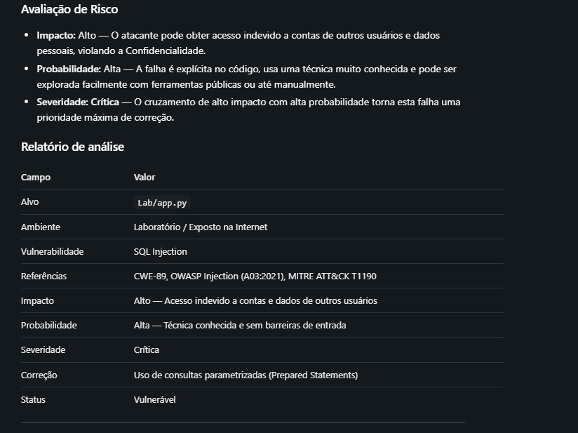
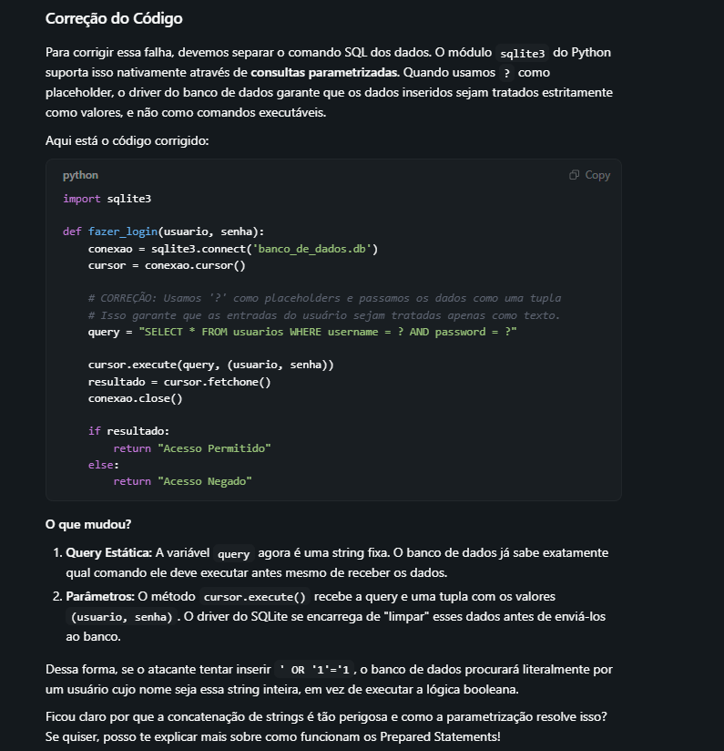

Desafio da dio

Objetivo: cria um GuardAi, um agente focado em Cybersegurança

Utilizei o Bionic como harness e o Gemma 4 12b QAT como modelo de linguagem.

[alt text](image.png)

° Criei uma skill chamada penetration-test que ensina o agente como funciona e o processo para fazer um teste de penetração.
° Dei a ele o conhecimento sobre osint(osint.md) e modelagem de ameaças(modeling-threat.md)
Obs: Dei ao agente apenas alguns poucos conhecimentos, não produzindo algo tão extenso

esse agente extente ao agente da dio: https://github.com/digitalinnovationone/dio-agent